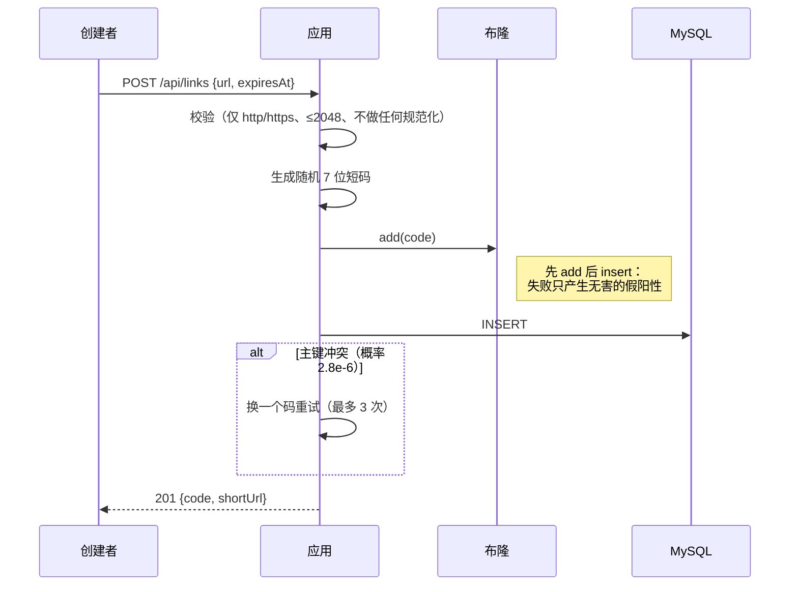
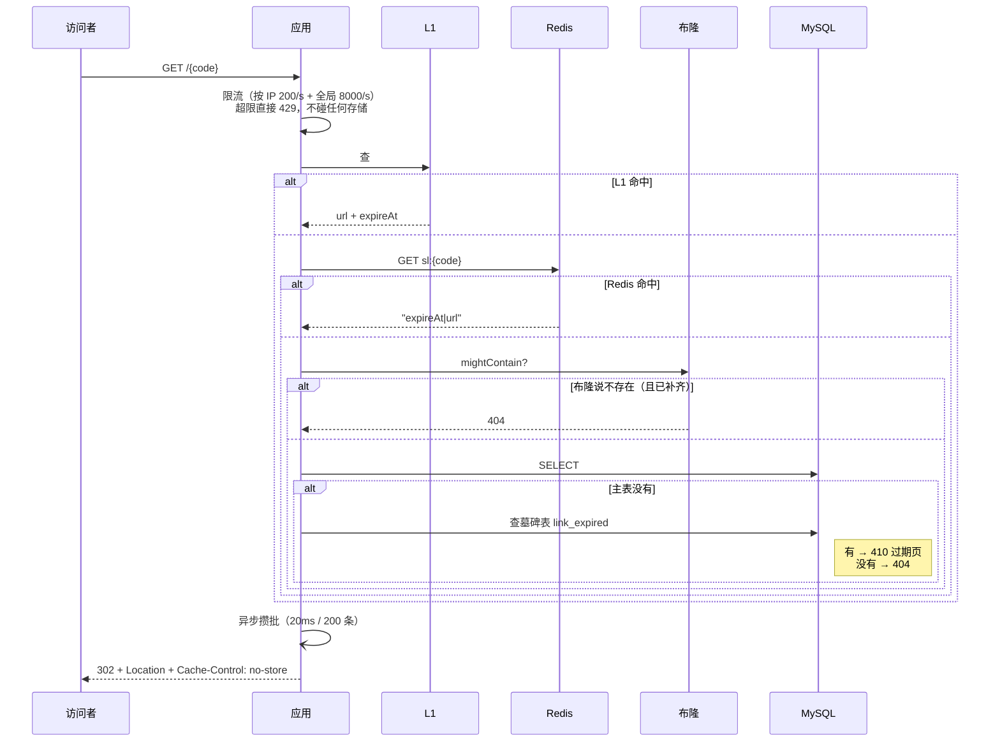
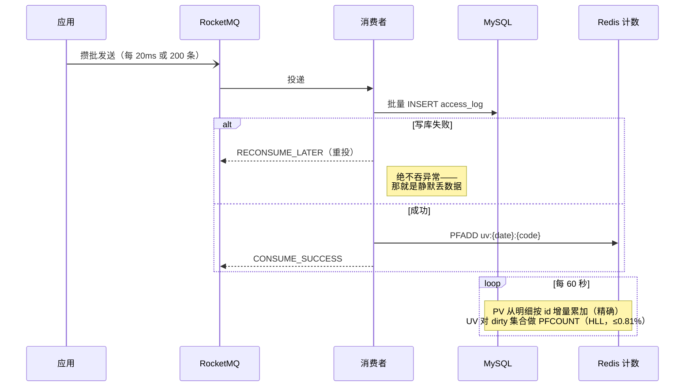

# 短链服务

一个单机短链服务：创建 → 跳转 → 统计。约束是需求定死的——**4C8G 单机、MySQL 单实例（buffer pool 1G）、Redis 单实例 1G、不允许集群**。

## 结果先说

在 **4C8G 等效**的 cgroup 限额下（4.0 核 / 6.9GB），1000 万行数据：

| 指标 | 实测 | 目标 | 结论 |
|---|---|---|---|
| 吞吐（900 QPS 稳态） | app CPU 136%，0 错误 | — | 稳定 |
| 峰值吞吐 | **约 1150–1250 QPS** | NFR-4：5000 QPS | **未达标，差约 4 倍** |
| 跳转延迟（预热后稳态） | p95 **16.7 ms** / med 0.86 ms | NFR-1：P99 ≤ 50 ms | 达标 |
| 跳转延迟（含冷启动的 120 秒窗口） | p95 **357 ms** / med 5.1 ms | — | 冷缓存穿透，见「已知问题」 |
| 缓存回源率（稳态） | **2.3%** | — | 见下方「缓存命中率」 |
| 同步主库写 | **0 次** | NFR-2：0 次 | 达标 |
| AC-2：1000 次随机码攻击 | **MySQL 查询增量 1** | 不随访问量同比例增长 | 达标 |
| AC-7：日报表 vs 明细 | **55 = 55，差 0** | 差值可解释 | 达标 |
| 全表重建布隆（1000 万行） | **15.9 秒** | — | — |

> **延迟口径必须说清楚**：
> - "16.7ms" 是**预热后 30 秒稳态**测的，工作集已经在 L1 里。
> - "357ms" 是**含冷启动的 120 秒窗口**，前 60 秒缓存是冷的，大量请求穿透到 MySQL。
> - 两个都是真的，**但引用时必须带上前提**——只报 16.7ms 会误导。

**没达标的部分我没有藏**：5000 QPS 差 4 倍，根因和证据在 [`docs/decisions.md` §19](docs/decisions.md)。一句话版本：

> 在 4C8G 里，"每次跳转发一条统计事件"就要吃掉跳转路径约 60% 的 CPU。
> 这不是调参能解决的，要继续提吞吐必须从架构上减少跳转路径的工作量。

### 为什么差 4 倍——把账算到底

先把预算摆出来：

```
app 的 cgroup 配额 = 1.4 核 = 每秒 1400ms CPU
5000 QPS  →  每请求只能用 0.28ms
实测 900 QPS 用 136% CPU  →  每请求 1.51ms
```

超预算 5.4 倍。但真正决定性的不是这个，是下面这组数：

| 场景 | 900 QPS 时 app CPU | 折合每请求 | 做 5000 QPS 需要 |
|---|---|---|---|
| **统计全关**（纯读路径） | 60% | **0.67 ms** | **3.3 核** |
| 统计全开 | 136% | 1.51 ms | 7.6 核 |

**即使把统计链路完全砍掉，5000 QPS 也需要应用独占 3.3 核——而整台机器只有 4 核，还要分给 MySQL、两个 Redis 和 RocketMQ。**

所以结论不是"再优化一下代码"，而是：**这套技术栈（Spring Boot + JVM）在 4C8G 上做 5000 QPS，前提就不成立。**
要真做到，只能换更轻的栈（Go / Netty 直接写响应），或者把每次响应的开销压到 0.28ms 以内。

这个测算是我认为整个项目最值钱的一段——**它把一个"没达标"变成了一个可证明的结论**。

## 快速开始

```bash
docker compose up -d --build
```

打开 <http://localhost:8080>，有一个演示页面：输入长 URL 生成短链，再按短码查 PV/UV。

> 页面是单文件静态页（`static/index.html` + 自托管的 `vue.global.prod.js`），**零构建、零额外容器**。
> Vue 不走 CDN —— 否则访客的 CDN 可达性会决定页面能不能显示，一个白屏的 demo 比朴素的 demo 糟得多。

### 环境和端口可以不改文件就切换

所有镜像源和宿主端口都读 `.env`（Compose 自动加载）：

```bash
cp .env.example .env
# 国内网络拉不动 Docker Hub 时，把 REGISTRY 改成加速地址（注意以 / 结尾）
# REGISTRY=docker.m.daocloud.io/
```

**默认端口是特意错开的**，不是笔误：

| 服务 | 宿主端口 | 为什么不是标准端口 |
|---|---|---|
| MySQL | `13306` | 很多开发机本地已经跑着 MySQL，3306 大概率被占 |
| Redis 缓存 / 计数 | `16379` / `16380` | 同上 |
| RocketMQ NameServer | `19876` | 避免和本机其它 MQ 冲突 |
| 应用 | `8080` | 标准 |

端口被占的话改 `.env` 即可，不用动 `docker-compose.yml`。

也可以直接用接口：

```bash
# 创建
curl -X POST localhost:8080/api/links \
  -H "Content-Type: application/json" \
  -d '{"url":"https://example.com/a/b?x=1&y=2"}'
# → {"code":"L4C73Ae","shortUrl":"http://localhost:8080/L4C73Ae",...}

# 跳转（-I 可以看到 Location 和 Cache-Control: no-store）
curl -I localhost:8080/L4C73Ae

# 统计
curl localhost:8080/api/stats/L4C73Ae
```

第三次请求就能访问到。宿主端口：应用 `8080`、MySQL `13306`、Redis `16379`、计数 Redis `16380`、RocketMQ `19876`。

> 本机 3306/6379 已被原生 MySQL/Redis 占用，所以容器端口做了映射。
> 全部容器走 compose 内网，不受影响。

## 架构

```mermaid
flowchart LR
    U[访问者] -->|GET /{code}| APP[Spring Boot]
    U -->|POST /api/links| APP

    APP --> L1[L1 Caffeine<br/>30 万条]
    L1 --> L2[(Redis 缓存<br/>700MB / allkeys-lru)]
    L2 --> BLOOM{{布隆过滤器<br/>16MB / 0.18%}}
    BLOOM --> DB[(MySQL 单表<br/>1000 万行 / 1G pool)]

    APP -.异步攒批.-> MQ[RocketMQ<br/>50 条消息/秒]
    MQ --> CON[消费者]
    CON -->|批量 INSERT| DB
    CON -->|PFADD| HLL[(Redis 计数<br/>300MB / noeviction)]

    JOB[每分钟聚合] --> HLL
    JOB --> DB
```

两个 Redis 实例不是为了扩容，是因为 **淘汰策略相反**：缓存要能淘汰，计数器被淘汰就是静默少算，而 `maxmemory-policy` 是实例级配置。

## 三条链路

### 创建



### 跳转



**关键点**：过期判定只认缓存值里的 `expireAt`，不认"Redis 里没有 key"——因为 LRU 驱逐和 TTL 到期在读取时无法区分。

### 统计



## 设计决策

七条决策、每条的好处/代价/对比、以及"当时答错的地方"，全部在 [`docs/decisions.md`](docs/decisions.md)。摘要：

| | 决策 | 一句话理由 | 主要代价 |
|---|---|---|---|
| D1 | 随机 7 位 + 主键兜底 | 防枚举；7 位在 1000 万下碰撞率 2.8e-6 | D3 必须付费（布隆） |
| D2 | Caffeine + Redis | p99 不继承 Redis、Redis 抖动时有缓冲 | **命中率零提升**（L1 ⊆ Redis） |
| D3 | 布隆 + 负缓存 + 限流 | 不存在码挡在进程内，不产生一次存储查询 | 位图落盘与补齐窗口 |
| D4 | RocketMQ 异步 + 批量写明细 | MySQL 侧故障时数据不丢、可重试 | 多一个进程，+1.5GB |
| D5 | HyperLogLog | 内存与 UV 规模解耦 | 0.81% 误差，挤占 URL 缓存 |
| D6 | 单表 | 1000 万量级分表收益接近 0 | buffer pool 装不下，85% 点查走盘 |
| D7 | 定时扫描 + 墓碑表 | 空间能回收，且过期链接仍答得出 410 | 多一张小表 |

## 缓存穿透 / 击穿 / 雪崩

| 问题 | 做法 | 实测 |
|---|---|---|
| **穿透** | 路由正则（零查询）→ 布隆（进程内 16MB）→ 负缓存（只承 1% 误判）→ 限流 | 1000 次攻击 → **MySQL 查询 1 次** |
| **击穿** | `CompletableFuture` 单飞：同一短码的并发未命中只查一次库 | 100 并发冷码 → **查询 2 次** |
| **雪崩** | TTL 随机抖动（打散同时过期）+ Redis 熔断器 + 熔断时把全局限流从 8000 降到 3500 | 停 Redis 打 300 次 → **0 失败，总耗时 3.4s** |

熔断这一条有个坑值得单说：**第一次测试时，停掉 Redis 后 300 个请求跑了 262 秒，最长单次 100 秒。**
原因是 Docker 停容器后 TCP 包被黑洞而非拒绝，Lettuce 每条命令要等约 20 秒才失败，
熔断器根本等不到足够的失败计数。改成 `DisconnectedBehavior.REJECT_COMMANDS` 后，
总耗时降到 3.4 秒——**快了 76 倍**。

> **"我加了熔断器"不等于"故障时服务可用"**：熔断的反应速度取决于底层客户端多久才肯承认失败，
> 这个数字必须实测。

代价也如实记着：TTL 抖动会让缓存略早过期；熔断期间正常用户可能被 429 误伤（这是"保住 MySQL"的取舍）。

## 缓存命中率（D2 论断的验证）

D2 当时的判断是：**"L1 ⊆ Redis，所以 L1 不提升命中率，只减少打到 Redis 的次数。"**

这个判断一直是推理，后来打开了 Caffeine 的 `recordStats()` 才拿到数据：

| | L1 命中率 | L1 未命中后 Redis 命中率 | **最终回源率** |
|---|---|---|---|
| 实测（T+120s） | **67.5%** | **92.9%** | **2.29%** |
| 没有 L1（推算） | — | 97.7% | **2.29%** |

**回源率一模一样。** L1 把 67.5% 的流量从 Redis 手上接走了，**一点没减少打 MySQL 的量**。

它买到的是另外两样：**p99 尾部不继承 Redis**、**Redis 抖动时的缓冲**（停 Redis 打 300 次，L1 扛住了 0 失败）。

> 这也是为什么 D2 的记录里写"命中率上零提升"——现在这句话有数据了。

## 组件挂掉会怎样

| 组件 | 用户还能点吗 | 兜底 | 实测 |
|---|---|---|---|
| **Redis 缓存** | ✅ | 熔断器跳过 Redis → L1 继续服务 → 全局限流降到 3500 | 300 次请求 **0 失败，3.4 秒** |
| **MySQL** | ⚠️ 部分 | 热码命中缓存仍 302；冷码 **503 + Retry-After**（1 秒，不是 30 秒） | ✅ |
| **MySQL（统计侧）** | ✅ | MQ 缓冲 + 幂等重投 | 停 30 秒：**53,889 条明细 0 丢失 0 重复** |
| **RocketMQ** | ✅ | 本地队列 5 万条 + 有界重试 | 跳转不受影响 |
| **布隆快照** | ✅ | `ready=false` 时不说"否"，全放行查库 | 重建 15.9 秒，期间**无 404** |
| **应用进程** | ✅ | `restart: unless-stopped` | 六个服务全部配置 |

**健康检查只把 `db`、`diskSpace` 算作必须的**（`/actuator/health/readiness`）——
Redis 挂了整体 health 会报 DOWN，但 readiness 仍是 UP，容器保持 healthy。
**否则会自己把正在降级服务的容器判死。**

完整矩阵和取舍理由见 [`docs/decisions.md` §24](docs/decisions.md)。

## 压测

```bash
# 1. 灌 1000 万行（约 80 分钟，可重复执行，非空会跳过）
#    bash:       docker exec -i shortlink-mysql mysql -uroot -proot shortlink < scripts/load-data.sql
#    PowerShell: Get-Content scripts/load-data.sql -Raw | docker exec -i shortlink-mysql mysql -uroot -proot shortlink
Get-Content scripts/load-data.sql -Raw | docker exec -i shortlink-mysql mysql -uroot -proot shortlink

# 2. 切到压测档（4 核 / 6.9GB 限额）
docker compose -f docker-compose.yml -f docker-compose.limit.yml up -d

# 3. 生成压测用的真实短码（与灌数据同一个置换公式）
pwsh scripts/gen-codes.ps1 -Count 20000

# 4. 稳态压测
docker run --rm --network shortlink-v2_default \
  -v "$PWD/scripts/k6:/scripts" -e BASE=http://shortlink-app:8080 \
  grafana/k6 run /scripts/steady.js
```

> **注意：压测必须用压测档。** 开发档有按 IP 200/s 的限流，k6 从单 IP 发压会让大部分请求变成 429——
> 我在这个坑里踩了三次，每次第一反应都是"缓存坏了"。
> 压测档通过 `SPRING_APPLICATION_JSON` 把按 IP 限流关掉（保留全局限流）。

改前/改后的四组 A/B（统计开/关、攒批前后、生产者/消费者拆分）见 [`docs/decisions.md` §19](docs/decisions.md)。

**必须标注**：以上数据是 **cgroup 模拟**的 4C8G，不是真机。IO 调度、NUMA、缓存层级都不同。

## 已知问题

1. **5000 QPS 未达标**（实测约 1250）。统计链路占用跳转路径约 60% CPU，见 §19。
2. **统计链路的 80 个 CPU 点未完全定位**。JFR 已排除 SecureRandom（那是延迟问题，已修），
   剩下的量与"入队 + 序列化 + 发送"对不上，需要继续做 `ThreadPark` 调用栈聚合。
3. **冷启动时连接池会被打满**。冷缓存 + 高 QPS 下出现
   `HikariPool: request timed out (active=20, waiting=108)`，实测 0.2% 请求失败。
   稳态回源率只有 2.3%，所以这是**冷启动现象**，正确修法是预热而不是加连接（MySQL 只有 1.4 核）。
4. **统计聚合是 O(活跃链数) 的逐条 UPDATE**。2 万个活跃码 = 每分钟 2 万条语句，
   是连接池压力的来源之一。应改批量 upsert，未做。
5. **明细保留 3 天、墓碑保留 90 天**。超过 90 天的过期短码会从 410 变成 404——这是
   "空间回收"与 AC-3"永远答得出过期页"之间的取舍，已在 §10 记录。
6. **压测机与被测机同机**。k6 和被测服务抢同一份 Docker CPU 配额，结果偏悲观。
7. **磁盘满未处理**。需要配额/告警体系，超出本项目范围。

> 完整的降级矩阵（每个组件挂了会怎样、实测结果）见 [`docs/decisions.md` §24](docs/decisions.md)。

## 目录

```
src/main/java/dev/shortlink/
  link/          短码生成、实体、仓储、创建服务
  redirect/      解析链：L1 → Redis → 布隆 → 负缓存 → MySQL → 墓碑
  dedup/         布隆过滤器（位图落盘 + 增量补齐）、负缓存
  ratelimit/     按 IP + 全局的滑动窗口计数（进程内，不碰 Redis）
  stats/         MQ 生产/消费、批量写明细、HLL、每分钟聚合、查询接口
  purge/         过期回收（主表 → 墓碑表）、明细/墓碑清理
  web/           三个入口 + 统一错误页
src/main/resources/static/
  index.html     演示页面（单文件 + Vue 3 自托管）
  vendor/        vue.global.prod.js
docs/
  requirements.md  需求（给定）
  decisions.md     决策记录 + 模块问答 + 压测数据（2100+ 行）
  resume/README.md 简历用的项目描述，含"每个数字在文档哪一节"的对照表
scripts/
  load-data.sql    1000 万行数据准备
  k6/              压测脚本
```
