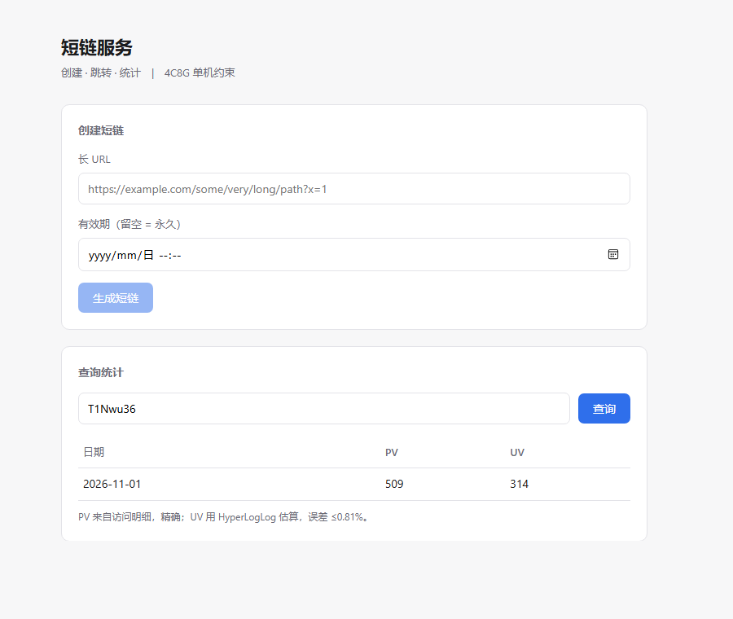
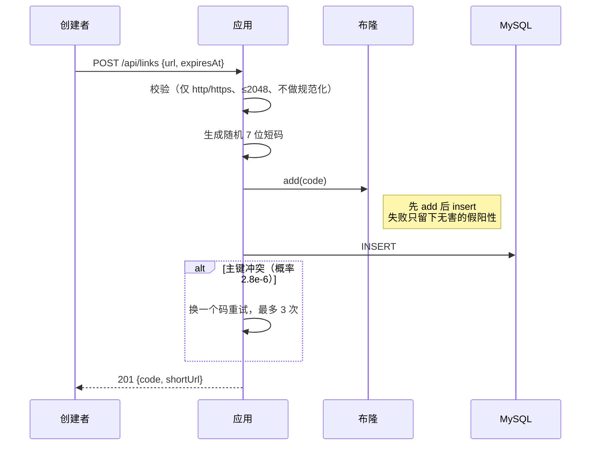
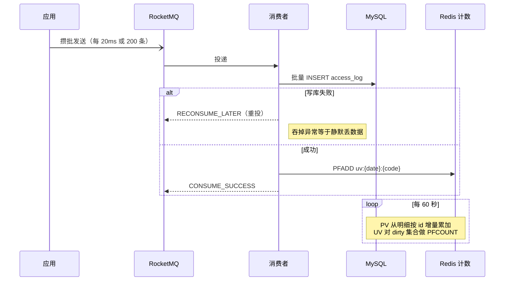

# 短链服务

创建短链 → 302 跳转 → 按天统计 PV/UV。

约束来自需求：4C8G 单机、MySQL 单实例（buffer pool 1G）、Redis 单实例 1G、不允许集群。
1000 万条数据实测表 3.7GB、索引 0.4GB，超出缓冲池容量，多数访问需要读盘，所以主要工作放在减少打到 MySQL 的请求。

## 实测数据

测试环境是按 4C8G 配的 cgroup 限额（4.0 核 / 6.9GB），非真机。

| 指标 | 实测 | 目标 | 结论 |
|---|---|---|---|
| 峰值吞吐 | 约 1150–1250 QPS | 5000 QPS | 未达标 |
| 跳转延迟（预热后稳态） | p95 16.7 ms / med 0.86 ms | P99 ≤ 50 ms | 达标 |
| 跳转延迟（含冷启动的 120 秒窗口） | p95 357 ms / med 5.1 ms | — | 见「已知问题」 |
| 缓存回源率（稳态） | 2.3% | — | 见「缓存命中率」 |
| 同步主库写 | 0 次 | 0 次 | 达标 |
| 1000 次随机码攻击 | MySQL 查询 1 次 | 不随访问量同比例增长 | 达标 |
| 日报表 vs 明细 | 55 = 55，差 0 | 差值可解释 | 达标 |
| 布隆全表重建（1000 万行） | 15.9 秒 | — | — |

两个延迟数字口径不同：16.7ms 是预热 30 秒后的稳态，工作集已经在 L1 里；357ms 覆盖了冷启动的 120 秒，前 60 秒缓存是冷的，大量请求穿透到 MySQL。

### 吞吐为什么差 4 倍

app 的 cgroup 配额是 1.4 核，即每秒 1400ms CPU。按 5000 QPS 算，每请求只能用 0.28ms；
实测 900 QPS 用掉 136% CPU，折合每请求 1.51ms。

| 场景 | 900 QPS 时 app CPU | 每请求 | 做 5000 QPS 需要 |
|---|---|---|---|
| 统计全关（纯读路径） | 60% | 0.67 ms | 3.3 核 |
| 统计全开 | 136% | 1.51 ms | 7.6 核 |

即使去掉统计链路，5000 QPS 也需要应用独占 3.3 核。整机只有 4 核，还要分给 MySQL、两个 Redis 和 RocketMQ。

结论是这套栈（Spring Boot + JVM）在 4C8G 上做 5000 QPS，前提不成立。要真做到只能换更轻的运行时，
或者把单次响应的开销压到 0.28ms 以内。A/B 拆解过程见 [`docs/decisions.md` §19](docs/decisions.md)。

## 快速开始

```bash
docker compose up -d --build
```

打开 <http://localhost:8080>：



页面是单文件静态页，用自托管的 Vue 3 运行时，没有构建步骤，也不额外起容器。
不引 CDN 的原因很简单：访客能不能访问 unpkg 不该决定这个页面能不能打开。

### 镜像源和端口

两者都读 `.env`，Compose 会自动加载：

```bash
cp .env.example .env
# 国内网络拉不动 Docker Hub 时改这一行（注意以 / 结尾）
# REGISTRY=docker.m.daocloud.io/
```

默认端口不是标准端口，是因为很多开发机本地已经跑着 MySQL 和 Redis：

| 服务 | 宿主端口 |
|---|---|
| MySQL | 13306 |
| Redis 缓存 / 计数 | 16379 / 16380 |
| RocketMQ NameServer | 19876 |
| 应用 | 8080 |

被占用的话改 `.env`，不用动 `docker-compose.yml`。

### 接口

```bash
# 创建
curl -X POST localhost:8080/api/links \
  -H "Content-Type: application/json" \
  -d '{"url":"https://example.com/a/b?x=1&y=2"}'
# → {"code":"L4C73Ae","shortUrl":"http://localhost:8080/L4C73Ae",...}

# 跳转（-I 可以看到 Location 和 Cache-Control: no-store）
curl -I localhost:8080/L4C73Ae

# 统计
curl localhost:8080/api/stats/L4C73Ae
```

## 架构

```mermaid
flowchart LR
    U[访问者] -->|GET /{code}| APP[Spring Boot]
    U -->|POST /api/links| APP

    APP --> L1[L1 Caffeine<br/>30 万条]
    L1 --> L2[(Redis 缓存<br/>700MB / allkeys-lru)]
    L2 --> BLOOM{{布隆过滤器<br/>16MB / 0.18%}}
    BLOOM --> DB[(MySQL 单表<br/>1000 万行 / 1G pool)]

    APP -.异步攒批.-> MQ[RocketMQ<br/>50 条消息/秒]
    MQ --> CON[消费者]
    CON -->|批量 INSERT| DB
    CON -->|PFADD| HLL[(Redis 计数<br/>300MB / noeviction)]

    JOB[每分钟聚合] --> HLL
    JOB --> DB
```

两个 Redis 实例不是为了扩容。缓存需要能淘汰，计数器不能淘汰，而 `maxmemory-policy` 是实例级配置，
一个实例装不下两套相反的策略。

## 三条链路

### 创建



### 跳转


过期判定只认缓存值里的 `expireAt`，不认「Redis 里没有这个 key」。因为 LRU 驱逐和 TTL 到期在读取时无法区分，
按「没有 key 就是过期」处理会把被驱逐的有效短链判成 410。

### 统计



## 设计决策

七条决策的选项、代价、取舍理由，以及被推翻过的地方，都在 [`docs/decisions.md`](docs/decisions.md)。

| | 决策 | 理由 | 代价 |
|---|---|---|---|
| D1 | 随机 7 位 + 主键兜底 | 防枚举；7 位在 1000 万下碰撞率 2.8e-6 | D3 必须付费（布隆） |
| D2 | Caffeine + Redis | p99 不继承 Redis、Redis 抖动时有缓冲 | 命中率零提升（L1 ⊆ Redis） |
| D3 | 布隆 + 负缓存 + 限流 | 不存在码挡在进程内，不产生存储查询 | 位图落盘与补齐窗口 |
| D4 | RocketMQ 异步 + 批量写明细 | MySQL 故障时数据不丢、可重试 | 多一个进程，+1.5GB |
| D5 | HyperLogLog | 内存与 UV 规模解耦 | 0.81% 误差，挤占 URL 缓存 |
| D6 | 单表 | 1000 万量级分表收益接近 0 | buffer pool 装不下，85% 点查走盘 |
| D7 | 定时扫描 + 墓碑表 | 空间能回收，过期链接仍答得出 410 | 多一张小表 |

## 缓存穿透 / 击穿 / 雪崩

| 问题 | 做法 | 实测 |
|---|---|---|
| 穿透 | 路由正则（零查询）→ 布隆（16MB，进程内）→ 负缓存（只承 1% 误判）→ 限流 | 1000 次攻击，MySQL 查询 1 次 |
| 击穿 | `CompletableFuture` 单飞：同码并发未命中只查一次库 | 100 并发冷码，查询 2 次 |
| 雪崩 | TTL 随机抖动 + Redis 熔断 + 熔断时全局限流降到 3500 | 停 Redis 打 300 次，0 失败，3.4 秒 |

熔断这块第一次测的时候是失败的：停掉 Redis 后 300 个请求跑了 262 秒，最长单次 100 秒。
原因是 Docker 停容器后 TCP 包被黑洞而不是被拒绝，Lettuce 每条命令要等 20 秒左右才返回失败，
熔断器等不到足够的失败计数。把 `DisconnectedBehavior` 改成 `REJECT_COMMANDS` 之后降到 3.4 秒。

代价也记着：TTL 抖动会让缓存比实际有效期早一点过期；熔断期间正常用户可能被 429 误伤，
这是为了保住 MySQL。

## 缓存命中率

D2 当初的判断是「L1 ⊆ Redis，所以 L1 不提升命中率，只减少打到 Redis 的次数」。这是推理，后来打开
Caffeine 的 `recordStats()` 才拿到数据：

| | L1 命中率 | L1 未命中后 Redis 命中率 | 最终回源率 |
|---|---|---|---|
| 实测（T+120s） | 67.5% | 92.9% | 2.29% |
| 没有 L1（推算） | — | 97.7% | 2.29% |

回源率一样。L1 把 67.5% 的流量从 Redis 接走，但没有减少打到 MySQL 的量。
它带来的是另外两件事：p99 不继承 Redis 的尾延迟，以及 Redis 抖动时还有一层缓冲。

## 组件挂掉会怎样

| 组件 | 用户还能点吗 | 兜底 | 实测 |
|---|---|---|---|
| Redis 缓存 | 能 | 熔断器跳过 Redis，L1 继续服务，全局限流降到 3500 | 300 次请求，0 失败，3.4 秒 |
| MySQL | 部分 | 命中缓存仍 302；冷码 503 + Retry-After | 1 秒返回，不是 30 秒 |
| MySQL（统计侧） | 能 | MQ 缓冲 + 幂等重投 | 停 30 秒，53,889 条明细 0 丢失 0 重复 |
| RocketMQ | 能 | 本地队列 5 万条 + 有界重试 | 跳转不受影响 |
| 布隆快照 | 能 | `ready=false` 时不回答「否」，全放行查库 | 重建 15.9 秒，期间无 404 |
| 应用进程 | 能 | `restart: unless-stopped` | 六个服务都配了 |

健康检查只把 `db` 和 `diskSpace` 算作必须项（`/actuator/health/readiness`）。
Redis 挂掉时整体 health 会报 DOWN，但 readiness 仍是 UP，容器保持 healthy。
如果按整体 health 判活，会把自己正在正常降级的容器杀掉。

完整矩阵见 [`docs/decisions.md` §24](docs/decisions.md)。

## 压测

```bash
# 1. 灌 1000 万行（约 80 分钟，可重复执行，非空会跳过）
#    bash:       docker exec -i shortlink-mysql mysql -uroot -proot shortlink < scripts/load-data.sql
#    PowerShell: Get-Content scripts/load-data.sql -Raw | docker exec -i shortlink-mysql mysql -uroot -proot shortlink
Get-Content scripts/load-data.sql -Raw | docker exec -i shortlink-mysql mysql -uroot -proot shortlink

# 2. 切到压测档
docker compose -f docker-compose.yml -f docker-compose.limit.yml up -d

# 3. 生成压测用的真实短码（和灌数据用同一个置换公式）
pwsh scripts/gen-codes.ps1 -Count 20000

# 4. 稳态压测
docker run --rm --network shortlink-v2_default \
  -v "$PWD/scripts/k6:/scripts" -e BASE=http://shortlink-app:8080 \
  grafana/k6 run /scripts/steady.js
```

压测要用压测档。开发档有按 IP 200/s 的限流，k6 从单 IP 发压会让大部分请求变成 429，
看起来像缓存失效。压测档通过 `SPRING_APPLICATION_JSON` 关掉按 IP 限流，保留全局限流。

A/B 的四组对照见 [`docs/decisions.md` §19](docs/decisions.md)。
所有数据都来自 cgroup 模拟的 4C8G，和真机在 IO 调度、NUMA、缓存层级上有差别。

## 已知问题

1. 5000 QPS 未达标，实测约 1250。统计链路占用跳转路径约 60% CPU，见 §19。
2. 统计链路剩下的 80 个 CPU 点没有定位完。JFR 已排除 SecureRandom（那是延迟问题，已修），
   剩余的量与「入队 + 序列化 + 发送」对不上，需要继续做 `ThreadPark` 的调用栈聚合。
3. 冷启动时连接池会打满。冷缓存加高 QPS 下出现 `HikariPool: request timed out (active=20, waiting=108)`，
   实测 0.2% 请求失败。稳态回源率只有 2.3%，所以是冷启动现象，修法应该是预热而不是加连接。
4. 统计聚合是 O(活跃链数) 的逐条 UPDATE。2 万个活跃码就是每分钟 2 万条语句，是连接池压力的来源之一。
   应改成批量 upsert，未做。
5. 明细保留 3 天，墓碑保留 90 天。超过 90 天的过期短码会从 410 变成 404，见 §10 的取舍。
6. 压测机与被测机同机，k6 和被测服务抢同一份 Docker CPU 配额，结果偏悲观。
7. 磁盘满未处理。

## 目录

```
src/main/java/dev/shortlink/
  link/          短码生成、实体、仓储、创建服务
  redirect/      解析链：L1 → Redis → 布隆 → 负缓存 → MySQL → 墓碑
  dedup/         布隆过滤器（位图落盘 + 增量补齐）、负缓存
  ratelimit/     按 IP + 全局的滑动窗口计数（进程内）
  stats/         MQ 生产/消费、批量写明细、HLL、每分钟聚合、查询接口
  purge/         过期回收（主表 → 墓碑表）、明细/墓碑清理
  web/           三个入口 + 统一错误页
src/main/resources/static/
  index.html     演示页面（单文件 + Vue 3 自托管）
  vendor/        vue.global.prod.js
docs/
  requirements.md  需求（给定）
  decisions.md     决策记录、模块问答、压测数据
  resume/README.md 简历用的项目描述
scripts/
  load-data.sql    1000 万行数据准备
  k6/              压测脚本
  bench/           A/B 实验用的 compose 覆盖文件
```
